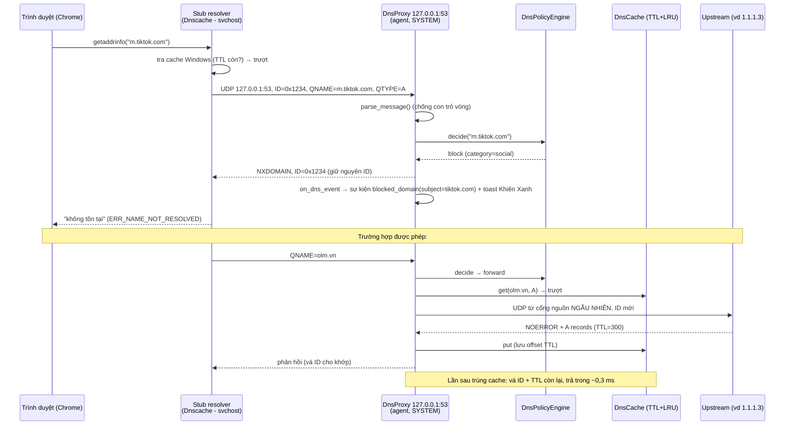

# OGK — Hướng dẫn Backend & Mạng (tài liệu ôn bảo vệ đồ án)

> **Dành cho:** cả nhóm, để đọc hiểu bản chất và tự tin trả lời vấn đáp cá nhân.
> **Cách đọc:** mỗi mục đều chỉ rõ *tệp/hàm* trong mã nguồn. Đọc tài liệu → mở đúng tệp → chạy test tương ứng (`pytest tests/<tệp> -v`). Phần nào chưa tự giải thích lại được bằng lời của mình thì chưa được coi là "hiểu".
> **Số liệu đo** ở §4 là số đo THẬT trên máy phát triển đêm 19/11/2026 — nhóm **phải đo lại** trên máy demo và ghi số của mình vào báo cáo (đề cấm số liệu giả).

---

## Mục lục
0. [Bản đồ mã nguồn](#0-bản-đồ-mã-nguồn)
1. [Luồng hoạt động end-to-end](#1-luồng-hoạt-động-end-to-end)
2. [Phân tích mã nguồn Server & Agent](#2-phân-tích-mã-nguồn)
3. [Bản chất các khái niệm Mạng & Hệ điều hành](#3-bản-chất-các-khái-niệm-mạng--hệ-điều-hành)
4. [Số liệu đo thực tế](#4-số-liệu-đo-thực-tế-đêm-19112026)
5. [Ngân hàng câu hỏi vấn đáp (18 câu)](#5-ngân-hàng-câu-hỏi-vấn-đáp)
6. [Giới hạn đã biết — nói thật khi bị hỏi](#6-giới-hạn-đã-biết)

---

## 0. Bản đồ mã nguồn

| Thành phần | Tệp chính | Yêu cầu đề |
|---|---|---|
| Đọc/ghi gói DNS (RFC 1035) | `agent/dns_wire.py` | F2, M1 |
| Quyết định chặn/cho phép/SafeSearch/DoH | `agent/domain_rules.py` | F2 |
| DNS proxy UDP+TCP 127.0.0.1:53, cache, upstream | `agent/dns_proxy.py` | F2, M1, M4 |
| Đồng hồ tin cậy (monotonic + Cristian) | `agent/clock.py` | F1, M6 |
| Lịch 7×48, quota thường/cuối tuần | `agent/schedule.py` | F1 |
| Máy trạng thái đếm giờ / cảnh báo / ân hạn / khóa | `agent/core.py` | F1, F4 |
| Kiểm soát ứng dụng SHA-256 | `agent/app_control.py` | F2 |
| Kiểm chữ ký chính sách | `agent/policy_verify.py` | F4 |
| SQLite cục bộ: chính sách, hàng đợi sự kiện | `agent/local_cache.py` | §4.3 |
| Heartbeat, lô sự kiện, refresh token, ghim TLS | `agent/sync.py` | §4.3, F5, M6 |
| WebSocket lệnh khẩn + backoff | `agent/ws_client.py` | §4.3 |
| Named Pipe / TCP loopback có token | `agent/ipc.py` | §4.2, P6 |
| DPAPI, ACL, khóa phiên, chạy Tray trong phiên trẻ | `agent/winsys.py` | F5 |
| Firewall, ép DNS card mạng, policy trình duyệt | `agent/netguard.py` | F2 (NÊN CÓ) |
| Lắp ráp agent | `agent/runtime.py`, `agent/run_agent.py`, `agent/service.py` | §4.2 |
| Tray cho trẻ | `agent/tray/app.py`, `view_logic.py`, `messages_vi.py` | §4.2, F3 |
| Mô hình dữ liệu 1:n:m | `server/models.py` | F4 |
| Chống IDOR ở tầng truy vấn | `server/access.py` | F5 |
| scrypt, AES-GCM, token, CSRF, rate limit | `server/security.py` | F5 |
| Ký chính sách | `server/signing.py`, `server/policy_service.py` | F4 |
| API agent (`/api/*`, WS) | `server/routers/agent_api.py` | §4.3 |
| Dashboard phụ huynh | `server/routers/dashboard.py`, `dashboard/templates/*` | F1–F4 |
| Báo cáo dùng chung | `server/reports.py`, `dashboard/templates/_report.html` | F3 |
| Xóa 90 ngày | `server/jobs.py` | F3 |

---

## 1. Luồng hoạt động end-to-end

### 1.1. Kiến trúc tổng thể

```text
 MÁY CỦA TRẺ (Windows)                                         MÁY CHỦ (LAN/VPS)
┌──────────────────────────────────────────────┐   HTTPS (TLS1.2+, ghim CA+lá)  ┌───────────────────────────┐
│ OGK Agent — Windows Service (LocalSystem, S0)│ ──── heartbeat 60s ───────────▶│ OGK Server (FastAPI)      │
│  tick 1s  ─ AgentCore (đếm giờ, khóa)        │ ──── POST /api/events (lô) ───▶│  /api/enroll /api/policy  │
│  2s       ─ AppController (SHA-256, kill)    │ ◀─── WS /api/ws (lệnh khẩn) ───│  /api/heartbeat /api/ws   │
│  sự kiện  ─ DnsProxy 127.0.0.1:53 UDP+TCP    │                                │  SQLite WAL + SQLAlchemy  │
│  SQLite   ─ LocalCache (chính sách, hàng đợi)│                                └────────────▲──────────────┘
└──────────────────▲───────────────────────────┘                                             │ HTTPS (cookie+CSRF)
                   │ Named Pipe \\.\pipe\ogk-agent (DACL: SY, BA, IU)              ┌────────────┴──────────────┐
┌──────────────────┴───────────────────────────┐                                │ Dashboard phụ huynh       │
│ OGK Kids — Tray (quyền của TRẺ, phiên 1)     │                                │ Jinja2 + HTMX, mobile     │
│  viên HUD, màn hình chặn, "Xin thêm giờ"     │                                └───────────────────────────┘
└──────────────────────────────────────────────┘
```

Hai bên (agent và dashboard) **không bao giờ nói chuyện trực tiếp**: mọi thứ đi qua server. Lý do: máy trẻ nằm sau NAT của mạng gia đình, không có IP công khai; agent chỉ cần kết nối **ra ngoài** (outbound) là đủ.

### 1.2. Luồng DNS: gói tin rời trình duyệt → bị chặn hoặc được trả lời



**Từng bước, từng byte** (truy vấn `tiktok.com` kiểu A, ID 0x1234):

```text
Truy vấn (28 byte):
12 34 | 01 00 | 00 01 | 00 00 | 00 00 | 00 00 | 06 74 69 6b 74 6f 6b 03 63 6f 6d 00 | 00 01 | 00 01
 ID     FLAGS   QD=1    AN=0    NS=0    AR=0     6 "tiktok"            3 "com"   0     A       IN
        └ 0x0100: RD=1 (xin đệ quy)

Phản hồi NXDOMAIN do proxy dựng (agent/dns_wire.py: build_error_response):
12 34 | 81 83 | 00 01 | 00 00 | 00 00 | 00 00 | (lặp lại question)
        └ 0x8183 = QR(0x8000) + RD(0x0100) + RA(0x0080) + RCODE=3 (NXDOMAIN)
```

Điểm phải nói được khi vấn đáp:
1. **Giữ đúng ID** — stub resolver ghép phản hồi với truy vấn bằng (ID, cổng nguồn, question). Sai ID → client bỏ gói và đợi tới timeout (vài giây) → người dùng thấy "chậm" thay vì "bị chặn ngay".
2. **NXDOMAIN thay vì trả IP 0.0.0.0**: trình duyệt báo lỗi ngay, không mở kết nối TCP tới đâu cả; không cần dựng trang chặn (mà với HTTPS cũng không dựng được — xem §3.2).
3. **Miền bị chặn không bao giờ rời máy** (test `test_block_subdomain_nxdomain_keeps_id` kiểm `upstream.count == 0`).
4. Trình duyệt chỉ thấy lỗi DNS, nên **Tray hiện toast** của Khiên Xanh để trẻ biết vì sao (nguyên tắc "không chặn im lặng"), gộp tối đa 1 lần/30 giây/tên miền (`runtime.py: TOAST_INTERVAL`).

### 1.3. Luồng SafeSearch qua CNAME

```text
Trẻ gõ google.com → stub hỏi proxy "www.google.com A?"
proxy: SAFESEARCH_MAP["www.google.com"] = "forcesafesearch.google.com"
proxy → upstream: "forcesafesearch.google.com A?" → 216.239.38.120
proxy → stub:  www.google.com  CNAME  forcesafesearch.google.com   (owner dùng con trỏ nén 0xC00C)
               forcesafesearch.google.com  A  216.239.38.120
Trình duyệt kết nối 216.239.38.120:443, SNI/Host vẫn là www.google.com → Google bắt buộc SafeSearch.
```
Đã kiểm chứng bằng `nslookup www.google.com 127.0.0.1` trên máy thật: trả `Name: forcesafesearch.google.com, Aliases: www.google.com, Address 216.239.38.120`.

### 1.4. Luồng ghép đôi (enrollment) — điểm ghi nhận sự đồng ý của cha mẹ

```mermaid
sequenceDiagram
    participant PH as Phụ huynh (dashboard)
    participant SV as Server
    participant AG as Agent (máy trẻ)
    PH->>SV: POST /children/{id}/pairing-code (cookie + CSRF)
    SV->>SV: code = 8 ký tự từ bảng 32 ký tự; lưu SHA-256(code), hạn 10 phút
    SV->>SV: audit "pairing.create" (ai, lúc nào, IP) = bằng chứng đồng ý
    SV-->>PH: hiển thị K7QM-2XPA + đếm ngược
    AG->>SV: POST /api/enroll {code, fingerprint=SHA256(MachineGuid|serial), hostname}
    SV->>SV: rate-limit 5/phút/IP; UPDATE ... SET used_at WHERE used_at IS NULL (dùng 1 lần, nguyên tử)
    SV-->>AG: device_id, access(15'), refresh(30 ngày), policy_alg, public key Ed25519
    AG->>AG: refresh token bọc DPAPI → SQLite trong %ProgramData%\OGK (ACL SYSTEM+Admins)
    AG->>SV: GET /api/policy → kiểm chữ ký → áp dụng
```

### 1.5. Luồng heartbeat 60 giây + đồng bộ giờ Cristian

```mermaid
sequenceDiagram
    participant AG as Agent (SyncLoop)
    participant SV as Server
    AG->>AG: t0 = monotonic()
    AG->>SV: POST /api/heartbeat {policy_version, state, client_time, integrity[]}
    SV->>SV: cập nhật last_seen, daily_usage = max(cũ, mới), ghi integrity_alerts
    SV-->>AG: {server_time T, policy_version, commands[], requests[]}
    AG->>AG: t1 = monotonic(); trusted = T + (t1 - t0)/2  (Cristian)
    alt version server ≠ version agent
        AG->>SV: GET /api/policy → verify (chữ ký + device_id + version tăng)
    end
    AG->>AG: áp lệnh chờ (bỏ qua command_id đã áp dụng)
    AG->>SV: POST /api/events (lô ≤ 200) → ACK → xóa khỏi hàng đợi
```
Heartbeat có jitter ±10% (`sync.py: SyncLoop.run`) để hàng nghìn máy không gửi cùng một giây.

### 1.6. Luồng lệnh khẩn qua WebSocket (< 5 giây)

```mermaid
sequenceDiagram
    participant PH as Phụ huynh
    participant SV as Server (Hub)
    participant AG as Agent
    AG->>SV: WS connect /api/ws (agent mở ra ngoài, xuyên NAT)
    AG->>SV: {"type":"auth","access_token":...}  (tin đầu tiên, KHÔNG để token trên URL)
    SV-->>AG: auth_ok + đẩy bù lệnh còn treo
    PH->>SV: POST /devices/{id}/command cmd=lock_now
    SV->>SV: INSERT commands(status=pending) TRƯỚC (bền vững)
    SV->>AG: {"type":"command","command_id":"c-1","cmd":"lock_now"}
    AG->>AG: mark_command_applied("c-1") = True lần đầu → core.apply_command
    AG-->>SV: {"type":"ack","command_id":"c-1"} → status=acked
    Note over SV,AG: Nếu WS rớt: heartbeat kế tiếp vẫn chở "c-1"; agent thấy đã áp dụng → bỏ qua.
```
- Server **ghi lệnh vào DB trước rồi mới đẩy** — nếu đẩy hụt, heartbeat là kênh dự phòng.
- Agent **khử trùng** bằng bảng `applied_commands` (`INSERT OR IGNORE` + `rowcount==1`) → "+15 phút" đến qua cả hai kênh vẫn chỉ cộng 15 (test `test_emergency_command_applied_once_via_ws_and_heartbeat`).
- Ping 20 giây giữ kết nối qua NAT/proxy (NAT thường xóa ánh xạ TCP rảnh sau vài phút).
- Rớt mạng → nối lại bằng backoff 1→30 giây có jitter (`ws_client.py: backoff_delay`).

### 1.7. Luồng ngoại tuyến & đồng bộ lô (idempotency)

```text
Mất mạng ──▶ agent vẫn: áp chính sách cache (đã kiểm chữ ký lại khi nạp), đếm giờ, chặn DNS/app
          ──▶ mỗi sự kiện được gắn idem_key = UUID4 NGAY LÚC TẠO, nằm trong event_queue (SQLite)
Có mạng  ──▶ POST /api/events {events: [≤200]}
             server: INSERT INTO events ... ON CONFLICT(idem_key) DO NOTHING
             server trả acked = mọi key hợp lệ + key bị loại
          ──▶ agent: DELETE khỏi hàng đợi CHỈ những key được ACK
Mất ACK giữa chừng (timeout) ──▶ gửi lại cả lô ──▶ server không tạo bản sao (đã có idem_key)
```
Ngữ nghĩa giao nhận: **at-least-once** (gửi ít nhất một lần) + **khử trùng phía nhận** = hiệu ứng **exactly-once**.

### 1.8. Luồng đổi chính sách (≤ 60 giây theo đề)
Phụ huynh lưu → server tạo hàng `policies` mới với `version = max+1` → audit (giá trị cũ/mới) → đẩy `{"type":"policy_changed"}` qua WS → agent `sync.wake()` → `GET /api/policy` ngay. Nếu WS không thông, heartbeat ≤ 66 giây (60 ± 10%) thấy lệch version và tải về — đây là **trần** thời gian.

---

## 2. Phân tích mã nguồn

### 2.1. Server (`/server`)

**Phân lớp:** `routers/*` (HTTP/WS) → `access.py`, `policy_service.py`, `reports.py`, `audit.py` (nghiệp vụ) → `models.py` (SQLAlchemy) → SQLite WAL (`db.py`).

**Mô hình dữ liệu 1 phụ huynh : n trẻ : m thiết bị** (`models.py`):
```text
parents 1──n children 1──n devices 1──n refresh_tokens / commands / daily_usage
   │              ├──n policies (UNIQUE(child_id, version))
   │              ├──n events  (7 trường + idem_key UNIQUE)
   │              └──n unlock_requests, integrity_alerts, kid_links
   └──n guardians (Ba, Mẹ...)        sessions (băm cookie) ── parents
```
Chính sách gắn với **trẻ** (mọi máy của trẻ dùng chung); khi tải về mới gắn `device_id` và ký riêng cho từng máy.

**Chống IDOR ở tầng truy vấn** (`access.py`):
```python
select(Device).join(Child, Device.child_id == Child.id)
              .where(Device.id == device_id, Child.parent_id == parent_id)   # sở hữu nằm TRONG WHERE
```
Không sở hữu → truy vấn rỗng → **404** (không phải 403: không xác nhận "id này có tồn tại"). Mọi route có id trên URL đều đi qua các hàm này (test `test_idor_parent_b_cannot_touch_child_of_a` thử 6 route).

**Xác thực phụ huynh** (`security.py`, `routers/auth.py`): scrypt N=2^15, r=8, p=1, muối 16 byte; `hmac.compare_digest`; 5 lần sai → khóa 15 phút (đếm theo **tài khoản**) + 10 lần/phút/IP (theo **IP**); email không tồn tại vẫn chạy scrypt giả để thời gian phản hồi không lộ email nào có thật.

**Phiên & CSRF** (`web.py`): cookie chỉ chứa chuỗi ngẫu nhiên 256 bit, DB lưu SHA-256 của nó (lộ DB không dùng lại được cookie). `HttpOnly; Secure; SameSite=Lax`, 12 giờ, đăng xuất **xóa phiên phía server**. CSRF token = `HMAC(secret, id_phiên)` — không cần lưu, gửi qua header `X-CSRF-Token` (HTMX đặt sẵn trên `<body hx-headers>`).

**Token thiết bị** (`security.py`, `agent_api.py`):
- *Access 15 phút* — **không trạng thái**: `base64(payload).HMAC-SHA256`. Server kiểm chữ ký không cần DB, nhưng vẫn tra cờ `devices.revoked` mỗi request → gỡ thiết bị có hiệu lực **ngay**.
- *Refresh 30 ngày, xoay vòng*: mỗi lần dùng → token cũ `revoked=True`, sinh token mới cùng `family_id`. Nếu token **đã xoay** bị dùng lại → nghi bị đánh cắp → thu hồi **cả họ** (test `test_refresh_rotation_and_reuse_detection`). Agent dùng `asyncio.Lock` để không bao giờ làm mới song song (tránh tự kích hoạt cơ chế này).

**Mã ghép** (`security.py: new_pairing_code`): 8 ký tự × log2(32)=5 bit = **40 bit** ≈ 1,1×10¹². Với 5 lần thử/phút/IP trong 10 phút: P(đoán trúng) ≈ 50/2⁴⁰ ≈ 4,5×10⁻¹¹. Server chỉ lưu SHA-256 của mã. Dùng một lần bằng **UPDATE có điều kiện** (`WHERE used_at IS NULL` + kiểm `rowcount == 1`) — nguyên tử ở tầng DB, hai agent gửi cùng mã đồng thời chỉ một người thắng.

**Chính sách có phiên bản + ký** (`policy_service.py`, `signing.py`): `version = max(version)+1` trong giao dịch; `UNIQUE(child_id, version)` là lưới an toàn nếu hai phụ huynh lưu cùng lúc. Phong bì: `{"alg", "body", "sig"}`, ký trên **canonical JSON** (sắp khóa, không khoảng trắng, UTF-8) — xem §2.2 về kiểm chữ ký.

**Sự kiện idempotent** (`agent_api.py: post_events`):
- `device_id`, `child_id` lấy **từ token**, không từ body (agent không ghi hộ máy khác).
- `subject` của sự kiện tên miền được server ép lại về **tên miền cấp hai** (không tin agent).
- Sự kiện sai định dạng **vẫn được ACK** (trong `rejected`) — nếu không, agent gửi lại mãi một "thông điệp độc" (poison message) và hàng đợi kẹt vĩnh viễn.
- Lô > 200 → 422 (Pydantic `max_length`).

**Heartbeat** (`agent_api.py: heartbeat`): `daily_usage.used_sec = max(cũ, mới)` — bộ đếm trong ngày chỉ tăng, chống agent bị sửa báo lùi. Trả `server_time` lấy **ngay trước khi trả** để Cristian chính xác nhất.

**WebSocket hub** (`ws_hub.py`): dict `device_id → WebSocket` trong RAM, khóa `asyncio.Lock`; một thiết bị một kết nối (kết nối mới đóng kết nối cũ). Giới hạn: một tiến trình — chạy nhiều worker cần Redis pub/sub.

**Báo cáo dùng chung** (`reports.py`): một hàm `child_report()` cấp dữ liệu cho dashboard, trang `/kid/{token}` và Tray (`/api/today`) → "trẻ thấy đúng những gì ba mẹ thấy, không hơn". Template `_report.html` dùng chung, `audience="kid"` chỉ đổi câu chữ và **ẩn số lần bị chặn** (không "đếm lỗi" trẻ).

**Đồng thời ở server:** FastAPI chạy route `def` (đồng bộ) trong threadpool, route `async def` trên event loop. SQLite WAL: **nhiều người đọc song song, một người ghi** tại một thời điểm; `busy_timeout=5000` khiến người ghi thứ hai chờ thay vì lỗi "database is locked". Với tải của đồ án (vài thiết bị, heartbeat 60 giây) WAL thừa sức.

**Header bảo mật** (`main.py`): CSP `script-src 'self'` (không inline script → XSS khó chèn mã), `X-Frame-Options: DENY` (chống clickjacking), `nosniff`. Trang `/kid/{token}` đặt `Referrer-Policy: no-referrer` vì token nằm trên URL.

### 2.2. Agent (`/agent`)

**`dns_wire.py` — tự viết bộ phân tích RFC 1035.** Lý do không dùng thư viện: để nhóm hiểu và trình bày được từng byte (M1), và kiểm soát chặt các trường hợp độc hại:
- `read_name()`: con trỏ nén (2 bit cao `11`) phải **trỏ lùi** và tối đa 16 lần nhảy → chống vòng lặp vô hạn (gói `C0 0C` trỏ vào chính nó bị loại — test `test_pointer_loop_is_rejected`).
- Kiểm nhãn ≤ 63 byte, tên ≤ 255 byte, bounds-check mọi lần đọc → gói cắt cụt ném `DNSParseError` → proxy trả FORMERR thay vì sập.
- `build_answer_response()` dùng con trỏ `0xC00C` cho owner name = minh họa nén.

**`domain_rules.py` — so khớp hậu tố theo nhãn.** `suffixes("a.b.facebook.com") = [a.b.facebook.com, b.facebook.com, facebook.com, com]`, tra từng hậu tố trong `set` → **O(số nhãn)**, thường 2–5 phép băm. Tại sao không trie? Với vài trăm–vài nghìn mục, set băm đơn giản hơn, nhanh tương đương và dễ giải thích. Tại sao không `endswith`? `"notfacebook.com".endswith("facebook.com") == True` → chặn nhầm. Thứ tự quyết định: canary → DoH → SafeSearch → **allow** → block → nhóm → ngân sách (allow thắng block; SafeSearch thắng cả allow).

**`dns_proxy.py` — asyncio.**
- Mỗi gói UDP sinh **một Task** (`ensure_future`) → truy vấn upstream chậm 2 giây không chặn truy vấn khác (test `test_concurrent_queries` gửi 50 truy vấn song song).
- Mỗi truy vấn upstream mở socket UDP **mới** → **cổng nguồn ngẫu nhiên** do OS cấp, kèm ID mới và kiểm (ID, question) của phản hồi → kẻ tấn công off-path phải đoán đúng 16 bit ID × ~16 bit cổng → chống đầu độc cache kiểu Kaminsky.
- Phản hồi có **TC=1** → hỏi lại upstream qua **TCP** (tiền tố độ dài 2 byte). Phản hồi gửi cho client vượt giới hạn UDP của client (512 hoặc kích thước EDNS0) → trả gói rỗng TC=1 để client tự hỏi lại qua TCP.
- Upstream lỗi/timeout → **SERVFAIL** (không im lặng để client treo).
- `Semaphore(256)` giới hạn truy vấn upstream song song → không bị lạm dụng làm bộ khuếch đại.
- **Cache**: `OrderedDict` = LRU (4096 mục); khóa `(qname, qtype, qclass)`; lưu **offset các trường TTL** lúc phân tích → khi trả từ cache vá ID (2 byte đầu) và ghi đè TTL = TTL gốc − thời gian đã nằm cache (client không giữ bản ghi lâu hơn chủ miền cho phép). Cache âm (NXDOMAIN) tối đa 60 giây. Không cache SERVFAIL/TC. Chính sách đổi → `flush_cache()` + `DnsFlushResolverCache()` của Windows (tương đương `ipconfig /flushdns`).

**`clock.py` — đồng hồ tin cậy.** `trusted_now = server_time_tại_neo + (monotonic() − mono_tại_neo)`. Phát hiện chỉnh giờ: theo dõi `wall − mono`; đổi > 60 giây → `ClockJump`. Khởi động lại khi offline: `restore_floor()` không cho giờ tin cậy nhỏ hơn giờ tin cậy cuối đã lưu (chống "lùi giờ rồi khởi động lại").

**`schedule.py`** — lịch là chuỗi 336 ký tự; `slot = thứ*48 + giờ*2 + phút//30`. `seconds_until_block()` dùng để cảnh báo trước khi **hết khung giờ** (không chỉ hết quota).

**`core.py` — máy trạng thái ACTIVE → GRACE(60s) → LOCKED**, logic thuần, trả về danh sách `Action` (sự kiện, khóa, thông báo) để lớp vỏ thực thi → test bằng đồng hồ giả, không cần Windows (17 test trong `test_time_core.py`). Các điểm kỹ thuật:
- `dt = min(monotonic − lần_trước, 5s)` → máy ngủ/treo không bị tính oan.
- Không đếm khi WTS báo khóa phiên, khi Tray báo rảnh > 300 giây, hoặc khi đang LOCKED.
- Sang ngày mới **chỉ khi ngày tin cậy tăng** (`today > self.day`, so sánh chuỗi ISO).
- Cảnh báo 10/5/1: mỗi ngưỡng **đúng một lần**; được thêm giờ thì "nạp lại" ngưỡng nằm trên thời gian còn lại.
- Ngân sách nhóm (vd games 45') là bộ đếm **độc lập**; hết ngân sách → `budgets_changed` → DNS chặn miền nhóm đó + AppController kết thúc app nhóm đó.
- `threading.RLock`: thread Named Pipe và event loop cùng chạm trạng thái.

**`app_control.py`** — SHA-256 theo khúc 1 MiB (tệp 2 GB không chiếm 2 GB RAM); cache theo `(đường dẫn, kích thước, mtime_ns)` → mỗi vòng quét 2 giây gần như chỉ tra dict. Thứ tự: `block_sha > allow_sha > block_name > allow_name` (băm là danh tính mạnh hơn tên). Danh sách tiến trình hệ thống được bảo vệ **chỉ khi tên khớp VÀ tệp nằm trong `%SystemRoot%`** — nếu chỉ xét tên, trẻ đổi `game.exe` → `svchost.exe` là thoát (test `test_rename_to_system_name_outside_windows_is_not_protected`).

**`policy_verify.py`** — 3 kiểm tra: (1) chữ ký đúng → chống **sửa**, (2) `device_id` khớp → chống **đem chính sách máy khác sang**, (3) `version > hiện tại` → chống **phát lại** bản cũ (vd bản có quota cao hơn). Thêm (0) `alg` phải đúng thuật toán đã chốt lúc ghép → chống **hạ cấp** từ Ed25519 sang HMAC. Chính sách trong cache cũng được **kiểm lại chữ ký khi nạp** (`runtime._load_cached_policy`).

> **Ed25519 hay HMAC?** Đề cho phép "HMAC hoặc chữ ký". Code hỗ trợ **cả hai** (`OGK_POLICY_ALG=ed25519|hmac-sha256`), mặc định **Ed25519**:
> - HMAC là đối xứng: ai **kiểm** được thì cũng **ký** được. Khóa HMAC phải nằm trên máy trẻ → nếu trẻ (hoặc mã độc chạy quyền admin) đọc được khóa là tự ký được chính sách "quota 999 phút".
> - Ed25519 là bất đối xứng: agent chỉ giữ **khóa công khai** → đọc được cũng vô dụng. Đúng nguyên tắc P6 "máy trẻ là môi trường không tin cậy".
> - HMAC vẫn có giá trị khi máy yếu/không có thư viện chữ ký; khi đó khóa **riêng từng thiết bị**, bọc DPAPI + ACL, server lưu mã hóa AES-GCM (`devices.hmac_key_enc`).

**`local_cache.py`** — SQLite WAL trong `%ProgramData%\OGK`; `event_queue` (at-least-once), `applied_commands` (khử trùng lệnh), `kv` (chính sách đã ký, token đã bọc DPAPI, snapshot bộ đếm 10 giây/lần). Hàng đợi có trần 50.000 sự kiện, bỏ `domain_query` cũ nhất trước (ít giá trị nhất).

**`sync.py`** — ghim TLS 2 lớp (CA riêng của lab trong `SSLContext` + SHA-256 chứng chỉ lá), `minimum_version = TLSv1_2`; tự làm mới access token khi còn < 30 giây hoặc gặp 401 (thử lại đúng 1 lần).

**`ipc.py`** — Named Pipe `\\.\pipe\ogk-agent` với SDDL `D:P(A;;GA;;;SY)(A;;GA;;;BA)(A;;GRGW;;;IU)` + `PIPE_REJECT_REMOTE_CLIENTS`; **danh sách trắng** `get_status, get_today, get_audit, request_more_time(15|30|60, lý do ≤200), report_idle, ack_break, ping`. Không có thao tác nguy hiểm nào — kể cả khi trẻ tự viết chương trình gửi thẳng vào pipe.

**`winsys.py`** — DPAPI (phạm vi tài khoản SYSTEM), ACL bằng **SID** (`S-1-5-18`, `S-1-5-32-544` — tên nhóm bị bản địa hóa trên Windows tiếng Việt), khóa phiên bằng `WTSDisconnectSession` (dịch vụ ở phiên 0 không gọi `LockWorkStation` thay trẻ được), chạy Tray trong phiên trẻ bằng `WTSQueryUserToken + CreateProcessAsUser`, `TrayWatchdog` (§5 câu 12).

**`netguard.py`** — xem §3.3 và câu hỏi 1.

**`runtime.py` — một event loop, nhiều coroutine:**

| Tác vụ | Chu kỳ | Ghi chú đồng thời |
|---|---|---|
| `tick_loop` | 1 s | `core.tick()` dưới `RLock` |
| `app_loop` | 2 s | `psutil.process_iter` chạy trong `run_in_executor` (API chặn) |
| `DnsProxy` | theo gói | mỗi gói một Task |
| `SyncLoop` | 60 s ±10% | đánh thức sớm bằng `asyncio.Event` |
| `ws_loop` | liên tục | backoff khi rớt |
| `persist_loop` | 10 s | snapshot bộ đếm |
| `guard_loop` | 30 s | watchdog Tray, kiểm tra DNS card mạng |
| Named Pipe | thread riêng | gọi coroutine qua `run_coroutine_threadsafe` |

**`tray/`** — Tray chỉ hiển thị và chuyển lời; logic hiển thị thuần (`view_logic.py`, `messages_vi.py`) tách khỏi Qt để test. Mẫu câu không chứa "vi phạm, cấm, phạt, lỗi của con, bị bắt, theo dõi" (test tự quét). Màn hình chặn luôn trả lời 3 câu: *chuyện gì — vì sao — làm gì được*.

---

## 3. Bản chất các khái niệm Mạng & Hệ điều hành

### 3.1. DNS
- **Phân cấp:** root `.` → TLD `com.` → miền `tiktok.com.`. Máy trẻ chỉ có **stub resolver** (Dnscache) — nó không tự đi hỏi từ root mà hỏi một **recursive resolver** (bình thường là router/ISP; khi cài OGK là `127.0.0.1`). Proxy của ta chính là "recursive resolver" giả: lọc rồi chuyển tiếp cho resolver thật (upstream).
- **UDP 53** cho truy vấn thường: không bắt tay, 1 gói đi 1 gói về → nhanh. Giới hạn 512 byte (RFC 1035) — **EDNS0** (RFC 6891, bản ghi OPT ở phần Additional) cho phép client quảng bá bộ đệm lớn hơn (thường 1232–4096). Câu trả lời quá lớn → server đặt **bit TC** → client hỏi lại qua **TCP 53** (mỗi thông điệp có tiền tố 2 byte độ dài vì TCP là luồng byte, không có ranh giới gói). TCP còn dùng cho chuyển vùng (AXFR).
- **Bản ghi:** `A` (IPv4, 4 byte), `AAAA` (IPv6, 16 byte), `CNAME` (bí danh: "tên này thực ra là tên kia" — client đi tiếp theo đích), `HTTPS/SVCB (65/64)` (trình duyệt hiện đại hỏi để biết ALPN/ECH), `SOA` (trong phần Authority của NXDOMAIN, cho TTL cache âm).
- **TTL & các tầng cache:** cache trình duyệt (~1 phút) → Dnscache của Windows → cache proxy → cache upstream. Hệ quả: **đổi chính sách xong phải xóa cache** cả proxy lẫn Windows, nếu không miền vừa chặn vẫn còn trả lời từ cache cho tới hết TTL.
- **Giới hạn bản chất của lọc DNS:** DNS chỉ thấy **tên miền**, không thấy đường dẫn (`youtube.com/watch?v=...`) hay nội dung → không chặn được "một video", chỉ chặn được "cả miền" (đây là lý do tối thiểu hóa dữ liệu cũng tự nhiên: ta chỉ *có* tên miền).

### 3.2. Vì sao ép SafeSearch bằng CNAME mà không lỗi HTTPS
Khi trả `www.google.com CNAME forcesafesearch.google.com`, trình duyệt **vẫn coi tên đích là www.google.com**: gửi SNI = `www.google.com`, kiểm chứng chỉ cho `www.google.com`. Máy chủ ở IP `forcesafesearch` là **của chính Google**, có chứng chỉ hợp lệ cho `*.google.com`, và luôn bật SafeSearch. Ta chỉ đổi **đường** chứ không giả **danh tính** → TLS hợp lệ. Ngược lại, muốn hiện "trang chặn" cho miền HTTPS thì phải giả chứng chỉ (MITM) → trình duyệt báo lỗi đỏ — vì thế ta chọn NXDOMAIN + toast trên Tray.

### 3.3. DNS-over-HTTPS (DoH) — điểm yếu chết người của lọc DNS và cách đối phó
DoH gói truy vấn DNS vào **HTTPS cổng 443** tới máy chủ như `dns.google`. Với hệ điều hành, đó chỉ là lưu lượng HTTPS bình thường → **đi vòng hoàn toàn** proxy 127.0.0.1:53. DoT (DNS-over-TLS) tương tự nhưng cổng **853**.

Phòng thủ nhiều lớp trong OGK:
| Lớp | Cơ chế | Mã |
|---|---|---|
| 1 | Trả NXDOMAIN cho **tên** các máy chủ DoH (`dns.google`, `cloudflare-dns.com`...) → trình duyệt không tìm được DoH server, quay về DNS hệ thống | `DOH_ENDPOINTS` |
| 2 | **Canary** `use-application-dns.net` → NXDOMAIN: Firefox tự tắt DoH mặc định | `DOH_CANARY` |
| 3 | **Policy HKLM** Chrome/Edge/Brave `DnsOverHttpsMode=off`, Firefox `DNSOverHTTPS.Enabled=0, Locked=1` (trẻ không đổi lại được trong Settings) | `BROWSER_POLICIES` |
| 4 | Firewall chặn **TCP 853** (DoT) đi ra | `build_firewall_commands` |
| 5 | Firewall chặn **TCP 443 tới IP của resolver công khai** (DoH bằng IP literal `https://1.1.1.1/dns-query` không cần DNS) | `DOH_IPS` |
Còn hở: máy chủ DoH **lạ/tự dựng**, VPN, proxy HTTPS → giải pháp triệt để cần lọc ở tầng TLS (SNI) hoặc WFP; ta ghi nhận là rủi ro chấp nhận (§6).

### 3.4. So sánh các phương án chặn (M2)
| Tiêu chí | Tệp `hosts` | **DNS proxy cục bộ (chọn)** | Proxy HTTP(S) | Bộ lọc WFP |
|---|---|---|---|---|
| Độ chính xác | Chỉ tên khớp chính xác, **không có wildcard** → không chặn được `*.tiktok.com` | Tên + mọi tên miền con, theo nhóm, SafeSearch | Tới từng URL (nếu giải mã TLS) | Theo IP/cổng/ứng dụng |
| Chặn được HTTPS | Có (ở mức tên) | Có (ở mức tên) | Chỉ khi MITM TLS (cài CA giả — xâm phạm, vỡ ghim chứng chỉ của app) | Có (mức kết nối) |
| Chi phí hiện thực | Rất thấp | Trung bình (viết parser, asyncio) | Cao | Rất cao (driver/C, ký số) |
| Khả năng bị vượt | Dễ (admin sửa tệp; DoH) | DoH/DoT/VPN/đổi DNS → cần netguard | VPN, ứng dụng bỏ qua proxy | Khó nhất |
| Hiệu năng | Không đáng kể | +~1 ms lượt đầu, ~0,3 ms khi trúng cache (§4) | Đáng kể (giải mã/mã hóa lại) | Thấp (trong nhân) |
Chọn DNS proxy: cân bằng tốt nhất giữa độ phủ, chi phí và **tôn trọng quyền riêng tư** (không giải mã nội dung).

### 3.5. Cô lập đặc quyền Windows: LocalSystem vs phiên người dùng
- Mỗi tiến trình mang một **access token** (SID người dùng + nhóm + đặc quyền). Dịch vụ OGK chạy bằng **LocalSystem** (SID `S-1-5-18`) — mạnh hơn cả Administrator trên máy cục bộ.
- **Session 0 isolation** (từ Vista): dịch vụ chạy ở **phiên 0**, không có desktop tương tác; trẻ đăng nhập ở phiên 1+. Hệ quả:
  - Trẻ (tài khoản **Standard**, không thuộc Administrators) **không** dừng được dịch vụ (`sc stop` → Access denied), **không** kill được tiến trình SYSTEM trong Task Manager, **không** đọc/ghi `%ProgramData%\OGK` (ACL chỉ SYSTEM + Administrators).
  - Ngược lại dịch vụ **không** vẽ được cửa sổ cho trẻ và không đọc được `GetLastInputInfo()` của phiên trẻ → cần **Tray** chạy trong phiên trẻ + **IPC**.
- **Nguyên tắc đặc quyền tối thiểu:** Tray chạy **bằng token của trẻ** (`CreateProcessAsUser`), không phải SYSTEM → lỗi trong Tray (Qt, xử lý chuỗi) không thành lỗ hổng leo thang đặc quyền.
- Nếu trẻ **là Administrator** thì mọi biện pháp phần mềm đều vượt được (dừng dịch vụ, sửa firewall) → đề yêu cầu tài khoản trẻ **không** thuộc Administrators; OGK vẫn phát hiện được một số dấu hiệu (heartbeat mất, `integrity_alerts`).

### 3.6. IPC: Named Pipe vs HTTP localhost có token
| | Named Pipe (chính) | HTTP/TCP 127.0.0.1 (dự phòng) |
|---|---|---|
| Kiểm quyền | **Hệ điều hành** kiểm DACL khi mở pipe (SY/BA toàn quyền, IU đọc/ghi) | Bất kỳ tiến trình nào trên máy cũng mở được cổng → **phải** có token |
| Bề mặt tấn công mạng | Không mở cổng; `PIPE_REJECT_REMOTE_CLIENTS` chặn truy cập qua SMB | Cổng loopback; trang web độc có thể gửi request tới `localhost` (CSRF tới localhost, DNS rebinding) → token + kiểm định dạng |
| Định danh client | Có thể lấy PID/SID client (`GetNamedPipeClientProcessId`) | Không |
Kênh TCP chỉ bật ở chế độ console để phát triển; dịch vụ thật dùng pipe. Token so sánh bằng `hmac.compare_digest`.

### 3.7. Thời gian: wall clock, monotonic, Cristian
- **Wall clock** (`time.time()`): người dùng/NTP sửa được, có thể nhảy lùi/tới.
- **Monotonic** (`time.monotonic()`, trên Windows dựa QueryPerformanceCounter): chỉ tăng, không bị chỉnh giờ ảnh hưởng, **reset khi khởi động lại** và không có nghĩa "mấy giờ".
- **Cristian:** gửi lúc t0, nhận lúc t1 kèm giờ server T ⇒ giờ server lúc nhận ≈ T + RTT/2, sai số tối đa ±RTT/2 (giả định đường đi/về đối xứng). LAN RTT vài ms ⇒ sai số vài ms — thừa đủ cho ô lịch 30 phút. (NTP tinh vi hơn: nhiều mẫu, lọc, ước lượng drift.)
- **Ngưỡng:** nhảy `|Δ(wall − mono)| > 60 s` ⇒ sự kiện chỉnh giờ; `|wall − trusted| > 120 s` ⇒ cảnh báo lệch giờ (hiện ở tab Thiết bị).

### 3.8. TLS & ghim chứng chỉ
TLS 1.2+ cho 3 tính chất: **bí mật** (mã hóa), **toàn vẹn** (MAC/AEAD), **xác thực server** (chuỗi chứng chỉ tới CA tin cậy). Ghim (pinning) thu hẹp "CA tin cậy" từ ~150 CA của hệ thống xuống **đúng CA của lab** (+ đúng chứng chỉ lá) → kể cả khi máy trẻ bị cài thêm CA giả (công cụ "chặn quảng cáo", proxy MITM) agent vẫn từ chối. `tools/gen_lab_ca.py` sinh CA EC P-256 + chứng chỉ server có SAN và in SHA-256 để ghim.

### 3.9. Idempotency & ngữ nghĩa giao nhận
- *At-most-once*: gửi một lần, mất thì thôi (mất sự kiện). *At-least-once*: gửi lại tới khi có ACK (có thể trùng). *Exactly-once* trên mạng không đảm bảo được ở tầng truyền ⇒ đạt **hiệu ứng** exactly-once bằng at-least-once + **khóa idempotency** phía nhận.
- OGK áp dụng ở **3 chỗ**: sự kiện (`events.idem_key UNIQUE`), lệnh khẩn (`applied_commands` ở agent), mã ghép (`UPDATE ... WHERE used_at IS NULL`).

---

## 4. Số liệu đo thực tế (đêm 19/11/2026)

> Máy phát triển Windows 11, Python 3.14, server và agent cùng máy, upstream 1.1.1.1. **Nhóm phải chạy lại trên máy demo** — số dưới đây chỉ để biết thứ tự độ lớn.

| Phép đo | Công cụ | Kết quả |
|---|---|---|
| DNS qua agent, lượt lạnh | `tools/measure_dns.py --samples 40` | n=20, p50 = 36,37 ms, p95 = 50,94 ms |
| DNS qua agent, lượt nóng (trúng cache proxy) | như trên | n=60, p50 = **0,32 ms**, p95 = 0,61 ms |
| DNS trực tiếp 1.1.1.1, lượt đầu | như trên | n=20, p50 = 35,57 ms, p95 = 42,45 ms |
| DNS trực tiếp 1.1.1.1, lặp lại | như trên | n=60, p50 = 35,83 ms, p95 = 40,67 ms |
| Trả NXDOMAIN (miền bị chặn) | `socket` thủ công | 0,2–0,5 ms/truy vấn |
| Lệnh khẩn dashboard → agent áp dụng (loopback) | script e2e | n=10, 5–10 ms |
| CPU / RAM agent lúc rảnh | `tools/measure_resources.py` | n=30, CPU p50 0,00% (max 0,19%), RAM ≈ 56 MB |
| Tỉ lệ chặn bộ 50 miền / dương tính giả 20 miền giáo dục | `test_block_rate_on_test_domains` | **50/50 (100%)**, **0/20** |

Lưu ý: lượt lạnh mới có 20 mẫu (< 30 theo đề) → chạy lại với `--samples 80`. Đo "lúc cao điểm" chưa làm: chạy `measure_dns.py --samples 400` song song với `measure_resources.py`.

---

## 5. Ngân hàng câu hỏi vấn đáp

### Nhóm A — Trẻ vượt rào

**Câu 1. Trẻ vào Settings đổi DNS card mạng sang 8.8.8.8. Hệ thống phản ứng thế nào? Chứng minh bằng code.**
> **Bản chất:** proxy chỉ lọc được truy vấn *đi qua nó*; đổi DNS card mạng là bỏ qua hoàn toàn 127.0.0.1.
> **Phòng thủ:** (1) Trẻ dùng tài khoản Standard → Windows yêu cầu quyền admin để đổi DNS adapter (UAC). (2) `netguard.ensure_dns_loopback()` chạy mỗi 30 giây trong `guard_loop`: phát hiện card có DNS ≠ 127.0.0.1 → đặt lại + ghi `integrity_alerts{kind: dns_changed}` cho phụ huynh. (3) Firewall chặn UDP/TCP **53 đi ra tới mọi IP trừ upstream** của agent (`build_firewall_commands`) → kể cả có đổi được DNS, gói tới 8.8.8.8:53 bị rớt.
> **Câu hỏi bẫy:** "Sao không viết luật *chặn 53 cho mọi chương trình trừ dịch vụ OGK*?" → Vì **Windows Firewall: luật CHẶN luôn thắng luật CHO PHÉP**; không có điều kiện "trừ chương trình X" trong một luật chặn. Ta đổi sang **phần bù dải IP** (`complement_ranges`). Kẽ hở còn lại: trẻ hỏi thẳng chính IP upstream → nên chọn upstream là resolver lọc gia đình (vd 1.1.1.3). Giải pháp triệt để: bộ lọc **WFP theo App-ID/Service SID**.

**Câu 2. Trẻ bật "Secure DNS" (DoH) trong Chrome. Kết quả? Vì sao DoH là điểm yếu bản chất của lọc DNS?**
> DoH bọc DNS trong HTTPS:443 → OS chỉ thấy một kết nối TLS tới `dns.google`, không thấy truy vấn. OGK: (1) policy HKLM `DnsOverHttpsMode=off` khóa luôn tùy chọn trong Chrome/Edge ("Managed by your organization"); (2) dù bật được, Chrome phải **phân giải tên `dns.google` qua DNS hệ thống** trước → proxy trả NXDOMAIN → Chrome **tự quay về DNS thường** (chế độ "automatic"); (3) chặn 443 tới IP resolver công khai cho trường hợp DoH bằng IP literal; (4) chặn 853 (DoT). Ghi kết quả thật vào báo cáo M3. Còn hở: DoH server lạ → rủi ro chấp nhận/WFP.

**Câu 3. Trẻ đổi `game.exe` thành `notepad.exe` (hoặc `svchost.exe`). Có qua được không?**
> Không. `AppRules.classify()` xét **mã băm SHA-256 trước tên**: băm phụ thuộc nội dung tệp, đổi tên không đổi băm. Đặc biệt: danh sách tiến trình hệ thống được bảo vệ **chỉ khi tên khớp VÀ đường dẫn nằm trong `%SystemRoot%`** (`is_protected()`); `C:\Users\Bin\Downloads\svchost.exe` không được bảo vệ. Test: `test_renamed_exe_is_still_detected`, `test_rename_to_system_name_outside_windows_is_not_protected`. Giới hạn: game **cập nhật** → băm đổi → vẫn còn luật theo tên; và trẻ chạy game portable chưa có trong danh sách thì chưa biết (cần danh sách cho phép thay vì danh sách chặn nếu muốn chặt).

**Câu 4. Trẻ lùi đồng hồ hệ thống 3 giờ (hoặc tua sang ngày mai) để được thêm quota. Code xử lý thế nào?**
> Thời lượng đếm bằng **hiệu monotonic** → chỉnh wall clock không ảnh hưởng. "Hôm nay là ngày nào" dùng **giờ tin cậy** = giờ server (Cristian) + monotonic đã trôi → tua sang mai không làm `today > self.day`. `check_wall_jump()` thấy `wall − mono` đổi −10800 s → Action `integrity` → server lưu `integrity_alerts` → dashboard hiện "⏰ đồng hồ bị chỉnh". Lùi giờ rồi **khởi động lại khi offline**: `restore_floor()` neo giờ tin cậy ≥ mốc cuối đã lưu. Test: `test_clock_rollback_3h_does_not_increase_quota`, `test_clock_forward_to_tomorrow_does_not_reset_day_when_synced`, `test_restart_after_rollback_keeps_usage`.
> **Nói thật giới hạn:** khởi động lại + offline + **tua tới** thì không phân biệt được với "tắt máy qua đêm thật" → có thể được quota ngày mới; khi có mạng lại server thấy lệch giờ.

**Câu 5. Trẻ mở Task Manager kill tiến trình agent / kill Tray.**
> Agent chạy **LocalSystem ở phiên 0**; trẻ không phải admin → "Access is denied". Nếu admin kill được: **SCM recovery** khởi động lại sau 5 giây (×3, reset sau 1 ngày) — cấu hình bằng `sc failure` trong `install.ps1`; heartbeat mất → dashboard "Ngoại tuyến". Kill **Tray** thì kiểm soát vẫn ở dịch vụ, và `TrayWatchdog` thấy Tray im lặng > 20 s → `CreateProcessAsUser` mở lại Tray.

**Câu 6. Trẻ dùng VPN / proxy công cộng / gõ thẳng địa chỉ IP / Safe Mode / boot USB / tài khoản Windows khác?**
> VPN/proxy: lưu lượng (kể cả DNS) đi trong đường hầm → lọc DNS bất lực; giảm thiểu bằng chặn miền nhà cung cấp VPN, tài khoản Standard không cài được driver VPN. IP trực tiếp: không có truy vấn DNS → không chặn được (nhưng hầu hết trang lớn dùng CDN + SNI nên vào bằng IP thường lỗi chứng chỉ). Safe Mode: dịch vụ không chạy (trừ khi đăng ký `SafeBoot\Network`) → cần mật khẩu BIOS/khóa tùy chọn khởi động. Boot USB: ngoài phạm vi phần mềm (khóa BIOS, BitLocker). Tài khoản khác: dịch vụ chạy theo **máy** nên vẫn lọc DNS cho mọi tài khoản; giờ dùng đếm theo phiên console. Điền cột "kết quả thử thật" trong M3.

### Nhóm B — Thiết kế & chịu lỗi

**Câu 7. Mất kết nối server nhiều ngày: fail-open hay fail-closed? Bảo vệ lựa chọn.**
> Chọn **lai, N = 7 ngày** (`core.time_policy`, `fail_mode`):
> - **Lọc nội dung: fail-closed** — giữ danh sách chặn cuối cùng mãi mãi. Lý do: rủi ro của nội dung độc hại không giảm theo thời gian; chặn thừa vài trang ít hại hơn mở toang.
> - **Thời gian: fail-open có giới hạn** — quá 7 ngày không liên lạc thì quay về mặc định an toàn 120 phút/ngày, 6:00–21:00. Lý do: nếu fail-closed (khóa máy) thì trẻ **không học/làm bài được** khi router hỏng hay server sập — hệ thống trừng phạt trẻ vì lỗi kỹ thuật, trái triết lý đồng hành; nếu fail-open hoàn toàn thì trẻ chỉ cần rút dây mạng là hết giới hạn.
> - "7 ngày" đo bằng **giờ tin cậy** (không phải giờ máy) và lưu xuống đĩa → không lách bằng chỉnh giờ hay khởi động lại.
> - Phương án bị loại: fail-closed toàn phần (hại việc học), fail-open toàn phần (rút dây mạng là thoát).

**Câu 8. Vì sao vừa có heartbeat 60 giây vừa có WebSocket? Bỏ một cái được không?**
> Heartbeat = **kéo**: đơn giản, bền (đi qua mọi proxy), nhưng trễ tới 60 s. WebSocket = **đẩy**: trễ ≈ 1 RTT (đo được 5–10 ms trong máy), nhưng kết nối dài hạn dễ bị NAT/proxy cắt. Hai kênh bổ trợ: WS cho tốc độ, heartbeat cho độ bền + đồng bộ giờ + báo trạng thái. Lệnh ghi DB trước, áp dụng idempotent theo `command_id` → đến hai lần vẫn chỉ áp một lần.

**Câu 9. Gửi lại lô sự kiện do mất ACK có làm báo cáo đếm gấp đôi? Hai lô trùng đến *đồng thời* thì sao?**
> Không. `idem_key` UUID sinh **lúc tạo sự kiện** (không phải lúc gửi) + `UNIQUE` + `INSERT … ON CONFLICT DO NOTHING`. Đồng thời: SQLite tuần tự hóa người ghi (WAL: một writer), ràng buộc UNIQUE đảm bảo chỉ một bản thắng — tính đúng không dựa vào câu `SELECT` kiểm trước (chỉ dùng để đếm). Test: `test_event_batch_sent_twice_is_not_duplicated`. Thêm: sự kiện hỏng vẫn được ACK để tránh poison message.

**Câu 10. Chữ ký chính sách: HMAC hay Ed25519? Trẻ là admin, sửa tệp SQLite cache tăng quota lên 999 phút?**
> Xem hộp ở §2.2. Sửa cache → khi nạp, `_load_cached_policy()` **kiểm lại chữ ký** → sai → dùng mặc định an toàn + `integrity_alerts{policy_cache_tampered}`. Phát lại bản chính sách cũ (quota cao hơn) → bị chặn bởi `version > hiện tại`. Đem chính sách máy anh/chị sang → sai `device_id`. Canonical JSON để server và agent băm **cùng một chuỗi byte** (test `test_canonical_json_same_on_server_and_agent`).

### Nhóm C — Hiệu năng

**Câu 11. Proxy viết bằng Python có làm chậm duyệt web? p50/p95 bao nhiêu, đo thế nào?**
> Đo (§4): lượt lạnh qua agent p50 36,4 ms vs trực tiếp 35,6 ms → proxy thêm **~1 ms** (bị lấn át bởi RTT tới upstream ~35 ms); lượt nóng **0,32 ms** nhờ cache (nhanh hơn hỏi thẳng 100 lần). Vì sao Python vẫn đủ nhanh: công việc chủ yếu là **I/O-bound** (chờ mạng), asyncio xử lý hàng nghìn truy vấn chờ đồng thời trên một thread; phần CPU (parse ~100 byte, vài phép tra set) chỉ vài chục µs. Thêm một tầng cache nữa: Dnscache Windows hấp thụ phần lớn truy vấn lặp trước khi tới proxy. Phương pháp: `perf_counter` độ phân giải µs, ≥ 30 mẫu, tách lượt lạnh/nóng, so cùng tập tên miền.

**Câu 12. Đề yêu cầu "nếu không hiển thị được biểu tượng thì agent phải tự dừng". Vậy trẻ chỉ cần kill Tray là thoát kiểm soát?**
> Không. `TrayWatchdog`: Tray im lặng > 20 s khi có phiên người dùng → **mở lại Tray** (`CreateProcessAsUser`). Chỉ khi mở lại **thất bại 3 lần liên tiếp** (máy không có giao diện, lỗi hệ thống) mới `suspend` kiểm soát + ghi `tray_unavailable` gửi phụ huynh. Như vậy: không bao giờ "kiểm soát vô hình" (chống stalkerware) mà cũng không có lỗ "kill Tray là thoát". Test: `test_tray_watchdog_relaunches_then_suspends`.

**Câu 13. Đếm giờ sai số ≤ ±30 giây/giờ đạt được thế nào? Máy ngủ thì sao?**
> Tick 1 s đo bằng hiệu monotonic thực (không cộng cứng "+1"), nên tick trễ (GC, tải CPU) không gây sai số tích lũy. Máy ngủ/hibernate: monotonic có thể nhảy lớn → chặn `dt ≤ 5 s` (test `test_sleep_gap_is_capped`). Không đếm khi khóa màn hình (WTS_SESSION_LOCK từ SCM) hoặc rảnh > 300 s (Tray báo `GetLastInputInfo`). Mất tối đa ≤ 5 s mỗi lần ngủ/thức.

### Nhóm D — Bảo mật & quyền riêng tư

**Câu 14. IDOR là gì? Chỉ ra dòng code chống IDOR. Vì sao trả 404 chứ không 403?**
> IDOR: đổi id trên URL để truy cập tài nguyên của người khác. Chống ở **tầng truy vấn**: điều kiện `Child.parent_id == parent_id` nằm trong `WHERE` (`server/access.py`), mọi route dùng chung → không thể "quên" ở một route. 404 không tiết lộ id đó có tồn tại (chống dò). Ẩn nút trên giao diện **không** phải là kiểm soát truy cập.

**Câu 15. Khóa bí mật cục bộ trên máy trẻ được bảo vệ ra sao?**
> (1) Agent **không giữ khóa ký** (Ed25519: chỉ khóa công khai). (2) Refresh token, khóa HMAC (nếu dùng) bọc **DPAPI** phạm vi tài khoản SYSTEM → chỉ tiến trình SYSTEM giải được; khóa chủ do Windows dẫn xuất, ta không tự giữ. (3) Thư mục `%ProgramData%\OGK` ACL **chỉ SYSTEM + Administrators** (bằng SID). (4) Refresh xoay vòng + phát hiện dùng lại → token bị trộm chỉ dùng được đến khi máy thật làm mới, sau đó cả họ token bị thu hồi. (5) Server: mật khẩu scrypt, trường nhạy cảm AES-256-GCM với **AAD = bảng.cột** (bản mã cột này dán sang cột khác không giải được — test `test_scrypt_and_aes_gcm_aad`), khóa từ biến môi trường.

**Câu 16. Làm sao bảo đảm OGK không bị biến tướng thành phần mềm theo dõi lén (stalkerware) người lớn?**
> Thiết kế, không chỉ chính sách: (1) **Không chế độ ẩn**: biểu tượng khay luôn hiện, menu không có "Thoát", watchdog — không hiện được thì **tự dừng**. (2) **Tối thiểu hóa dữ liệu**: chỉ tên ứng dụng + **tên miền cấp hai** (server ép lại), không URL, không nội dung, không ảnh màn hình, không phím gõ — lược đồ sự kiện đúng 7 trường. (3) **Minh bạch hai chiều**: người bị quản lý xem được *đúng* dữ liệu phụ huynh thấy và nhật ký "ai đổi gì" (NT5). (4) Ghép đôi cần **mã do chủ tài khoản tạo** + audit đồng ý; cài đặt cần quyền admin máy đó. (5) Tên dịch vụ/tiến trình thật ("OpenGuard Kids Agent"), không giả mạo. (6) README nêu phạm vi sử dụng hợp pháp. Kẻ xấu vẫn có thể cài lên máy người lớn mình có quyền admin — nhưng nạn nhân **thấy biểu tượng và đọc được mọi thứ bị ghi** → mất giá trị "lén".

**Câu 17. CSRF trong dashboard được chống thế nào? SameSite=Lax chưa đủ sao?**
> Lớp 1: cookie `SameSite=Lax` — trình duyệt không gửi cookie trong POST xuyên trang. Lớp 2: token `HMAC(secret, id_phiên)` bắt buộc trong header `X-CSRF-Token`/trường ẩn cho mọi thao tác ghi (`form_with_csrf`). Lax chưa đủ vì: trình duyệt cũ, các yêu cầu GET có tác dụng phụ, subdomain cùng site… Trang độc không đọc được token vì **Same-Origin Policy**. Test: `test_write_without_csrf_rejected`.

**Câu 18. Trẻ tự viết chương trình gửi lệnh vào Named Pipe để "tự cộng giờ" hoặc tắt lọc?**
> Pipe chỉ nhận **danh sách trắng thao tác vô hại** (`ALLOWED_OPS`); không có `add_time`, `set_policy`, `disable_filter`, `stop_service`. Mọi tham số được kiểm (phút ∈ {15,30,60}, lý do ≤ 200 ký tự, idle trong khoảng hợp lệ). "Xin thêm giờ" chỉ **tạo yêu cầu** lên server; quyết định thuộc về phụ huynh, và giờ chỉ được cộng khi agent nhận lệnh **có xác thực từ server**. Test: `test_ipc_rejects_ops_outside_whitelist`, `test_ipc_validates_arguments`.

---

## 6. Giới hạn đã biết

Nói thật khi bị hỏi — giảng viên đánh giá cao việc hiểu giới hạn hơn là tuyên bố "chặn được hết":
1. Lọc DNS không thấy URL/nội dung; VPN, DoH lạ, IP trực tiếp vượt được ở mức nhất định (§3.3, câu 6).
2. Tua đồng hồ tới + khởi động lại + offline không phân biệt được với qua đêm thật (câu 4).
3. Firewall "phần bù IP" vẫn để ngỏ chính IP upstream (câu 1) — giải pháp WFP chưa làm.
4. Hub WebSocket và rate limiter nằm trong RAM của một tiến trình (không scale nhiều worker).
5. Dịch vụ Windows (`service.py`, `CreateProcessAsUser`, `WTSDisconnectSession`, firewall, registry) **chưa được kiểm chứng trên máy sạch** — mới chạy ở chế độ console; cần thử trên máy ảo theo `agent/INSTALL.md`.
6. Quota tính **theo từng máy**; trẻ có 2 máy thì mỗi máy một quota (chưa gộp phía server).
